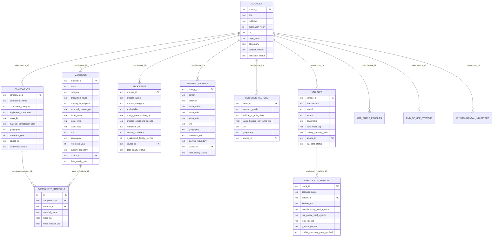

# Green Auto India — Automotive Life Cycle Assessment (LCA) Data Platform

**Techfest IIT Bombay 2026–27 Challenge 2 — Engineering LCA Database, Search Engine, Ingestion Pipeline & Analytics Platform**

---

## 1. Platform Overview & Scientific Integrity Architecture

**Green Auto India** transforms the **Automotive Life-Cycle Assessment Reference Data Pack (Research snapshot: 18 October 2026)** into a normalized, persistent relational SQL database (`data/green_auto_india.sqlite` via `better-sqlite3` WAL mode), a modular calculation engine, a relevance-ranked full-text & synonym search engine, a CSV data ingestion pipeline, and an 11-module interactive engineering frontend.

### Core Scientific Guardrails Enforced
1. **Zero Fabricated Values**: Missing numerical values in the supplied PDF (e.g., Polymer Injection Moulding in Section 4 Table 4, exact retail vehicle BOMs, or static CEA Indian grid numbers without a specified fiscal year/margin) are explicitly stored as `NULL` with clear data-quality flags rather than invented numbers.
2. **Screening Ranges Preserved**: Section 2 material screening factors (e.g., Carbon steel `~1.5–2.8 kg CO2e/kg`, Primary Aluminium `~8–18 kg CO2e/kg`, Recycled Aluminium `~0.5–2.5 kg CO2e/kg`) are stored and propagated through the LCA calculator as `[min, midpoint, max]` ranges.
3. **Allocated Facility Process Guard**: Section 4 (PMC10890010 Table 4) includes 6 allocated plant/facility services (`Painting` = 4,167 MJ & 268 kg CO2/kg, `Welding` = 920 MJ & 62 kg CO2/kg, `HVAC & lighting` = 3,335 MJ & 225 kg CO2/kg, `Heating`, `Compressed air`, `Material handling`). These are flagged with `is_allocated_facility_service = 1` and automatically blocked from indiscriminate multiplication by total vehicle mass.
4. **Well-to-Tank (WTT) vs Tank-to-Wheel (TTW) Separation**: Tailpipe combustion emissions are strictly separated from upstream fuel production and grid electricity generation so combustion-only petrol is never compared unfairly against lifecycle BEV electricity.
5. **Double-Counting Prevention**:
   - If a published whole-vehicle manufacturing footprint already includes cradle-to-gate materials, individual BOM material footprints are automatically zeroed in the total sum.
   - If logistics flows are marked as already included in supplier cradle-to-gate datasets, separate transport summation is suppressed.
   - Under `Cut-off` End-of-Life allocation (or when recycled input shares are already applied in the BOM), End-of-Life avoided-burden credits are suppressed to prevent double counting recycling benefits.

---

## 2. Quick Start & Local Development Instructions

### Prerequisites
- **Node.js**: v20+ or v22+
- **npm**: v10+

### Step 1: Install Dependencies
```bash
cd C:\Users\hp\.gemini\antigravity\scratch\green-auto-india
npm install
```

### Step 2: Run Database Migrations & Seed from Reference PDF
```bash
npm run db:migrate
```
This initializes `data/green_auto_india.sqlite` with all 12 normalized tables, foreign keys, and indexes, and seeds **135 source-linked records** extracted from the Reference Data Pack.

To regenerate the normalized intermediate JSON snapshot (`data/extracted_intermediate/pdf_reference_pack_normalized.json`):
```bash
npm run db:ingest-pdf
```

### Step 3: Run Automated Unit & Integration Tests
```bash
npm test
```
Executes Vitest suites verifying range propagation, double-counting guards, allocated facility service guards, all 10 benchmark natural-language search queries, and persistent CSV ingestion.

### Step 4: Launch Backend & Frontend Development Servers
```bash
npm run dev
```
- **Backend REST API Server**: `http://localhost:3001`
- **Interactive Frontend Dashboard**: `http://localhost:5173`

---

## 3. Normalized Relational Database Schema (ER Diagram)



---

## 4. Data Dictionary

| Table | Field | Type | Unit / Format | Description & Scientific Rule |
| :--- | :--- | :--- | :--- | :--- |
| `materials` | `primary_or_recycled` | `TEXT` | Enum | Strictly separates `'Primary'`, `'Recycled/Secondary'`, `'Mixed/Unspecified'`, and `'Pack/Assembly'`. |
| `materials` | `factor_min`, `factor_max` | `REAL` | `kg CO2e/kg` | Preserves Section 2 screening ranges without collapsing into a single false-precision value. |
| `components` | `mass_kg` | `REAL` | `kg` | Total component or depolluted vehicle mass (`1,137 kg` for EU SWD(2023) 256 baselines). |
| `component_materials` | `mass_fraction_pct` | `REAL` | `%` (0–100) | Share of component mass represented by each constituent material. |
| `processes` | `energy_consumption_mj` | `REAL` | `MJ/kg processed` | Process energy intensity from PMC10890010 Table 4. |
| `processes` | `process_emissions_kgco2e` | `REAL` | `kg CO2/kg processed` | Gate-to-gate or allocated facility CO2 intensity. |
| `processes` | `is_allocated_facility_service` | `INTEGER` | `0` or `1` | When `1` (Welding, Painting, HVAC, Heating, Compressed air, Material handling), blocks multiplication by total vehicle mass. |
| `energy_factors` | `lifecycle_boundary` | `TEXT` | Enum | Separates `'Tank-to-Wheel (Combustion Only)'`, `'Well-to-Tank (Upstream Production & Delivery)'`, `'Well-to-Wheel / Full Lifecycle'`, and `'Generation Grid Mix'`. |
| `vehicles` | `electric_utility_factor` | `REAL` | `0.0` to `1.0` | Fraction of lifetime kilometres driven on electricity (0 for ICEV/HEV, 0–1 for PHEV, 1.0 for BEV). |
| `end_of_life_systems` | `allocation_method` | `TEXT` | Enum | `'Cut-off (Recycled Content)'` vs `'Avoided Burden (End-of-Life Recycling Credit)'`. |

---

## 5. Summary of Imported Records & Extraction Audit Report

- **14 Registered Sources (`sources`)**: Full provenance for the Reference Data Pack, EU SWD(2023) 256, PMC10890010 (2024), IEA Global Hydrogen Review (2024), CEA CDM CO2 Baseline Database, Nature Communications India LCA (2022 / PMC9018792), Argonne GREET 2025 Rev.1, GREET VMC (2020), GREET Battery BOM Update (2025 / BatPaC 5.2), ANL Cradle-to-Grave Report, UMich CSS (2012), Mamarikas et al. (2026), CEEW Auto Decarbonisation, and SAE 2006-01-0375.
- **12 Material Records (`materials`)**: All 10 Section 2 screening materials + 2 additional BOM materials from Section 3 (`Manganese`, `Glass-fibre reinforced plastic`).
- **10 Component & BOM Records (`components`) + 48 Junction Rows (`component_materials`)**: All 4 EU SWD(2023) 256 depolluted 1,137 kg powertrains (`ICEV`, `HEV`, `PHEV`, `BEV` × 12 material rows each) + 6 qualitative subsystem mappings (`BIW`, `ICE Engine`, `Electric Motor`, `Wiring`, `Tyres`, `Traction Battery`).
- **16 Manufacturing Processes (`processes`)**: All 15 processes from Section 4 Table 4 (10 direct processes + 6 flagged allocated facility services) + 1 explicit data-gap record for `Polymer injection moulding`.
- **12 Energy Carrier Pathways (`energy_factors`)**: Includes IEA 2024 Hydrogen ranges (`10–12 kg CO2e/kg H2` from unabated natural gas, `22–26 kg CO2e/kg H2` from unabated coal), electrolytic hydrogen, CEA India grid electricity, Solar PV, Wind, Petrol (TTW & WTT separated), Diesel (TTW & WTT separated), CNG (WTW), and Biofuels.
- **4 Freight Logistics Modes (`logistics_factors`)**: Road freight, Rail freight, Coastal shipping, and Supplier-to-plant inbound/outbound logistics.
- **7 Representative Vehicle Case-Study Archetypes (`vehicles`)**: Small Petrol Hatchback, Diesel Passenger Car/SUV, CNG Passenger Car, Full Hybrid (HEV), Plug-in Hybrid (PHEV), Battery Electric Vehicle (BEV), and Hydrogen Fuel-Cell Electric Vehicle (FCEV).
- **3 Use-Phase Profiles (`use_phase_profiles`)**, **3 End-of-Life Allocation Systems (`end_of_life_systems`)**, and **6 Environmental Indicators (`environmental_indicators`)**.
